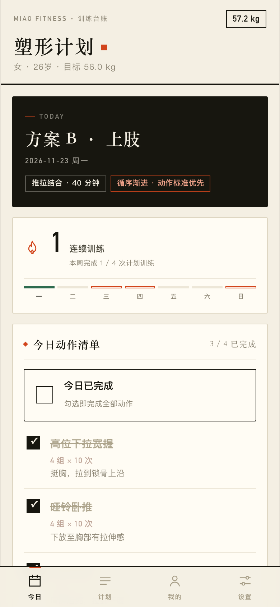
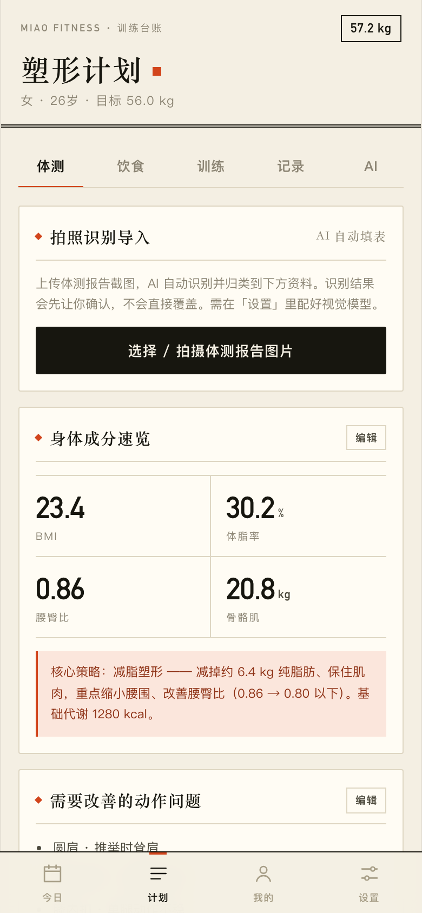
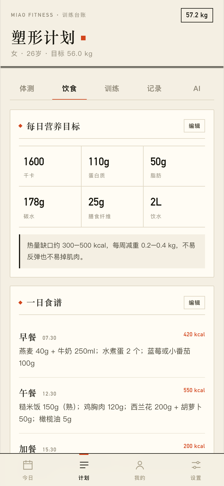
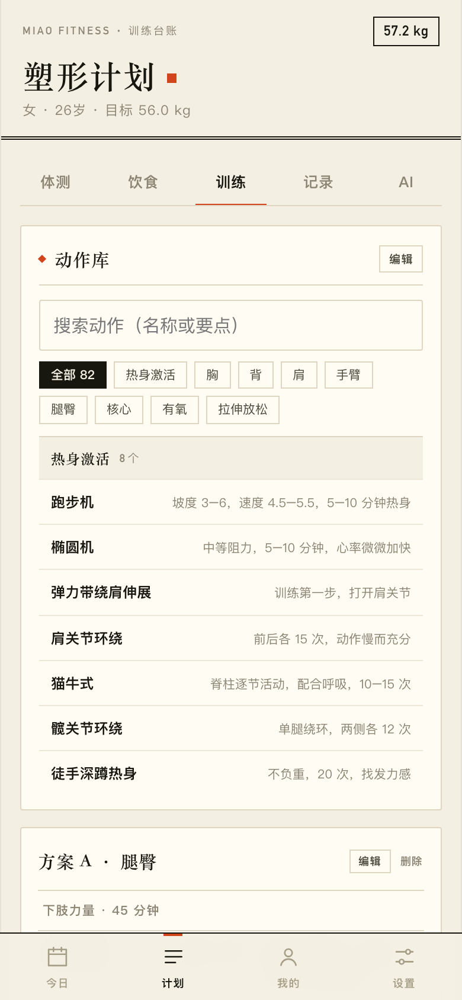
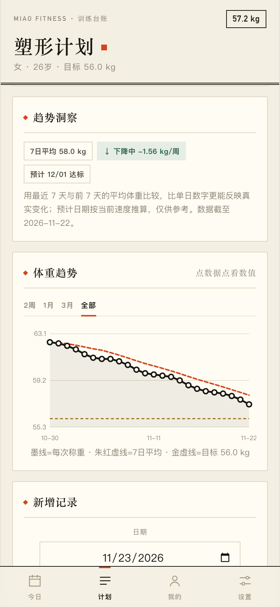
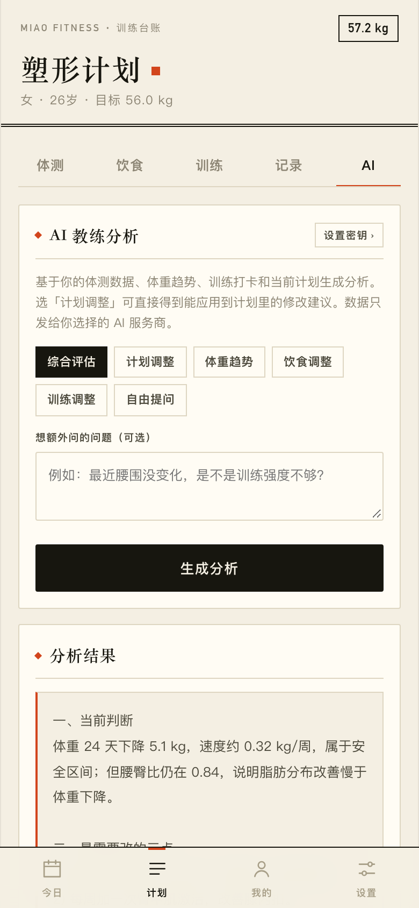
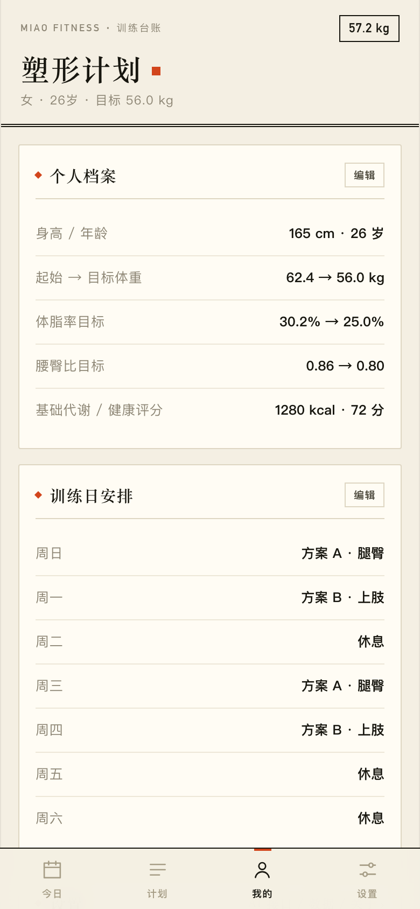
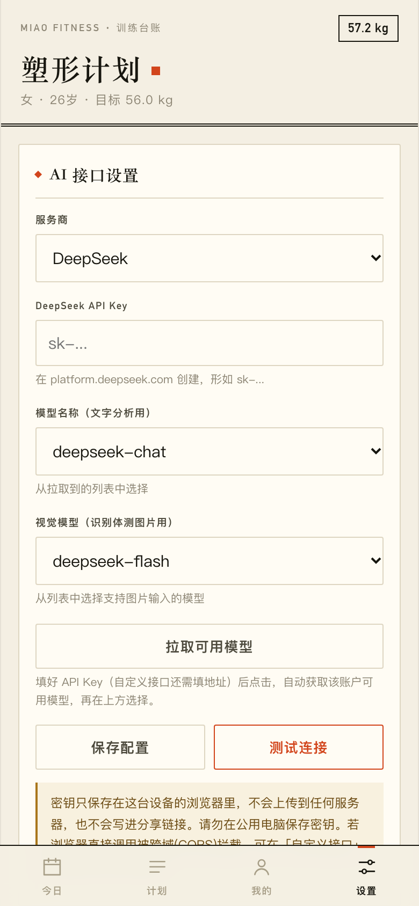
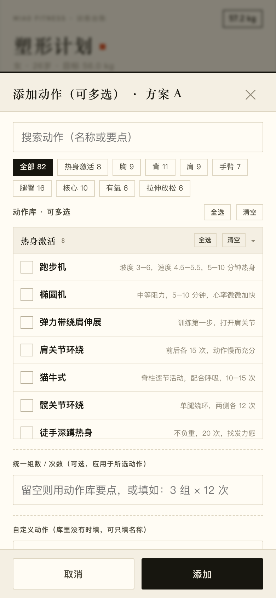

# 喵喵健身（Miao Fitness）

一个**离线优先**的个人健身与体测管理 App：训练计划、动作库、打卡、体重曲线、体测报告识别、AI 教练建议，全部装在一个页面里。

- **不需要账号，不需要联网**：档案、计划、打卡、体重、历史记录都存在你自己的设备上；只有你主动点「生成分析」时才会把数据发给你自己配置的 AI 服务商。
- **单文件页面 + 原生壳**：界面是一份 HTML（`ios/FitnessPlan/Resources/index.html`），iOS 是 WKWebView 壳，Android 是 WebView 壳，两端共用同一套界面与逻辑。
- **数据不丢**：iOS 端每次保存都会同步写一份沙盒备份，页面加载前自动回填；本地服务固定端口，退出重进仍是同一份数据。

| 平台 | 最低版本 | 产物 |
| --- | --- | --- |
| iOS | iOS 15.0（arm64） | `miaomiao-fitness.ipa`（ad-hoc 签名） |
| Android | Android 5.0 / API 21 | `miaomiao-fitness.apk` |
| 浏览器 | 任意现代浏览器 | 直接打开 `index.html` 即可 |

> 仓库里的档案与体重默认值是通用空模板，原始个人数据未包含。

---

## 界面预览

界面走的是**印刷台账风**：暖纸底、墨黑字、发丝线、宋体数字，只保留一个朱红强调色。以下截图均为 iPhone 尺寸下的实际界面。

| 今日 | 体测 | 饮食 |
| :---: | :---: | :---: |
|  |  |  |
| 今日方案、连续训练、动作勾选 | 身体成分、核心策略、拍照识别 | 每日营养目标与一日食谱 |

| 训练 | 记录 | AI 教练 |
| :---: | :---: | :---: |
|  |  |  |
| 动作库与方案 A–D | 体重概况、趋势洞察、趋势图 | 六种分析类型、流式输出 |

| 我的 | 设置 | 动作选择器 |
| :---: | :---: | :---: |
|  |  |  |
| 个人档案与训练日安排 | AI 接口与数据管理 | 分类筛选、搜索、批量勾选 |

---

## 目录

- [界面预览](#界面预览)
- [界面地图](#界面地图)
- [功能详解](#功能详解)
  - [今日：今天的训练与打卡](#今日今天的训练与打卡)
  - [体测：身体数据与报告识别](#体测身体数据与报告识别)
  - [饮食：每日营养目标与食谱](#饮食每日营养目标与食谱)
  - [训练：方案、动作库与周安排](#训练方案动作库与周安排)
  - [记录：体重趋势与历史](#记录体重趋势与历史)
  - [AI 教练：分析、历史与一键填写](#ai-教练分析历史与一键填写)
  - [我的：个人档案与训练日安排](#我的个人档案与训练日安排)
  - [设置：AI 接口与数据管理](#设置ai-接口与数据管理)
- [快速上手：第一次使用](#快速上手第一次使用)
- [详细使用教程](#详细使用教程)
- [安装](#安装)
- [数据存储与备份](#数据存储与备份)
- [常见问题](#常见问题)
- [从源码构建](#从源码构建)
- [GitHub Actions 一键出双端包](#github-actions-一键出双端包)
- [目录结构](#目录结构)
- [免责声明](#免责声明)

---

## 界面地图

底部四个 Tab，计划页内再分五个分段：

```
今日  │ 今天的训练方案、动作打卡、快速记体重
计划  │ 体测 · 饮食 · 训练 · 记录 · AI
我的  │ 个人档案、训练日安排、设置入口
设置  │ AI 接口、数据管理、关于
```

| 位置 | 主要卡片 |
| --- | --- |
| 今日 | 今日方案、连续训练与本周进度、今日动作清单、快速记体重 |
| 计划 → 体测 | 拍照识别导入、身体成分速览、核心策略、需要改善的动作问题 |
| 计划 → 饮食 | 每日营养目标、一日食谱、饮食原则 |
| 计划 → 训练 | 动作库、训练方案 A / B / C / D… |
| 计划 → 记录 | 体重概况、趋势洞察、体重趋势图、新增记录、历史记录 |
| 计划 → AI | 分析类型、附加问题、分析结果、一键填写、分析历史 |
| 我的 | 个人档案、训练日安排 |
| 设置 | AI 接口设置、数据管理、关于 |

页面上的「编辑」「✎」都是就地弹窗编辑，保存后立刻写盘并刷新界面，不需要刷新页面。

---

## 功能详解

### 今日：今天的训练与打卡

- **今日方案自动确定**：根据「我的 → 训练日安排」里今天对应的是休息还是某个方案，自动显示方案标题、说明和动作清单。
- **训练节奏**：顶部显示「连续 N 次训练」和「本周完成 x / y 次计划训练」，下面一排星期圆点标记本周每天的完成情况。
- **今日动作清单**：每个动作显示名称、组数次数、要点说明，左侧勾选即代表完成。
  - 标题右侧的「勾选即完成全部动作」可以一次全选 / 全不选。
  - 「+ 添加动作（仅当天）」从动作库勾选，只影响今天的清单，不改动方案本身，适合临时加练或替换。
  - 休息日显示「今天是休息日，好好恢复 💚」，也可以勾选记录。
- **快速记体重**：输入 kg 直接保存，写入当天体重记录；同一天重复记录会覆盖而不是新增。

### 体测：身体数据与报告识别

- **拍照识别导入**：上传或拍摄体测报告截图，AI 识别后把身高、年龄、性别、体重、BMI、体脂率、腰臀比、骨骼肌、基础代谢、健康评分、身体年龄等字段列出来，**逐项勾选确认后才写入**，不会直接覆盖已有数据。识别到的体测日期会作为体重记录的日期。
  - 识别完可以直接「确认导入」，也可以「导入并一键调整计划」，让 AI 根据新数据提出计划修改建议。
  - 需要先在设置里配好支持图片输入的**视觉模型**。
- **身体成分速览**：BMI、体脂率、腰臀比、骨骼肌四项指标，点「编辑」可改。
- **核心策略**：根据起始体重与目标体重自动算出要减的脂肪量、腰臀比改善目标（当前 → 目标）和基础代谢。
- **需要改善的动作问题**：一行一个标签，例如圆肩、骨盆前倾、膝内扣，编辑时每行写一条。

### 饮食：每日营养目标与食谱

- **每日营养目标**：热量、蛋白质、脂肪、碳水、膳食纤维、饮水，六个数字一目了然；下面附热量缺口与每周预期减重速度。
- **一日食谱**：早餐 / 午餐 / 加餐 / 晚餐，每餐包含时间、热量、具体食物与克数；加餐会提示「傍晚训练则移到训练前 1 小时」。
- **饮食原则**：高蛋白优先、粗细粮搭配、控制糖与酒精、补足无机盐、足量蔬菜等，可自行增删改。
- 所有内容都可以手动编辑，也可以让 AI 生成建议后通过「一键填写」批量替换。

### 训练：方案、动作库与周安排

- **训练方案**：默认有方案 A / B / C 三个训练方案和一个「休息 / 主动恢复」。方案 A / B / C 可以留空，也可以随意编辑标题、说明和动作。
- **新增方案**：点「+ 添加方案（D / E / F ...）」，按 A→Z 顺序自动取一个没用过的字母；方案可随时删除，删除后每周安排里引用它的日子需要重新选。
- **每个方案**：显示动作列表（动作 | 组数次数 | 说明），支持「+ 添加动作」「✎ 编辑」「删除」。点「✎ 编辑」会用文本框列出整份方案，每行 `动作 | 组数次数 | 说明`，改完保存即可，删掉某行就是删除该动作。
- **添加动作是勾选式的**：
  - 顶部是分类筛选（全部 / 热身激活 / 胸 / 背 / 肩 / 手臂 / 腿臀 / 核心 / 有氧 / 拉伸放松 / 其他），每个分类带数量。
  - 支持按动作名称或要点搜索，按分类分组折叠浏览。
  - 可单个勾选，也可「全选 / 清空」，还能对单个分类「全选 / 清空」。
  - 在「统一组数 / 次数」里填一段文字（如 `3 组 × 12 次`），会作为本次所选动作的组数次数；留空则只带动作库里的要点。
  - 动作库里没有的动作用底部「自定义动作」临时添加，只填名称也行。
- **动作库**：内置 80+ 标准动作（热身、胸、背、肩、手臂、腿臀、核心、有氧、拉伸），每行格式为：

  ```
  动作名称 | 动作要点 | 分类
  ```

  分类可以留空——标准动作会按内置对照表自动归类，自定义动作归入「其他」。也可以写自定义分类名，筛选栏会自动出现这个分类。

### 记录：体重趋势与历史

- **体重概况**：当前体重、相对起始体重的累计变化、距目标还差多少（达标则显示「达成」）、记录次数。
- **趋势洞察**：用最近 7 天平均体重与前 7 天平均体重比较，给出 7 日平均、趋势方向（下降中 / 平台期 / 上升中）、每周变化速度，以及按当前速度推算的预计达标日期。**记录满一周后才显示速度**，因为单日体重波动没有参考价值。
- **体重趋势图**：绿线是每次称重，橙虚线是 7 日平均，黄虚线是目标体重；可切换「2 周 / 1 月 / 3 月 / 全部」，点数据点看具体数值。
- **新增记录**：选日期 + 填体重，保存后写入历史。
- **历史记录**：倒序列出所有记录，可「修改」或「删除」；删错了可以点「撤销」恢复。

### AI 教练：分析、历史与一键填写

**六种分析类型**

| 类型 | 用途 |
| --- | --- |
| 综合评估 | 综合体测、体重、打卡、计划，指出最需要改善的 2–3 点，给未来两周的整体建议 |
| 计划调整 | 直接产出可应用到计划里的修改项，配合「一键填写」使用 |
| 体重趋势 | 解读近期体重变化，判断是平台期还是速度过快 |
| 饮食调整 | 根据目标与进度调整热量与三大营养素 |
| 训练调整 | 调整方案结构、动作选择与组数次数 |
| 自由提问 | 在下方输入框写自己的问题 |

- 可以在「想额外问的问题（可选）」里补充说明，例如「最近右肩不舒服，推举想换成别的」。
- 生成过程是流式输出，可随时点「停止」。
- **一问一答完成后，补充问题的输入框会自动清空**，方便直接输入下一个问题；若本次请求失败或中途停止，输入内容会保留，改完可直接重试。清空前的问题会记在历史里，不会丢。
- 结果支持「复制结果」「存入历史」「↩ 撤销」。
- 送的上下文包括：个人档案与体测数据、体重趋势、训练打卡记录、当前方案与周安排、饮食计划。

**一键填写到各板块**

AI 给出建议后，不需要手动抄到各个页面：

1. 点「从分析文字提取」，自动从分析结果里解析出可填写的字段（也可「+ 手动添加填写项」自己指定字段和值）。
2. 面板按 **体测 / 身体数据、饮食计划、训练方案、每周训练安排、动作库** 五组展示，每项显示「当前值 → 建议值」。
3. 按分组勾选要应用的部分，支持分组全选 / 全不选、顶部「全选 / 全不选」，数值项可以就地微调。
4. 点「一键填写选中项」一次性写入。应用前会自动保存快照，点「↩ 撤销上次填写」可整体回滚。

**分析历史**：每次生成的结果都会按时间保存，点历史记录可以回看，也能直接载入当时提出的填写建议再应用一次。

### 我的：个人档案与训练日安排

**个人档案**（点「编辑」修改）

| 字段 | 说明 |
| --- | --- |
| 性别、年龄、身高 | 计算 BMI、基础代谢的基础 |
| 起始体重 / 目标体重 | 用于计算累计变化与距目标差值 |
| BMI、体脂率、腰臀比、骨骼肌 | 体测数据，可手填也可用拍照识别导入 |
| 目标体脂率 / 目标腰臀比 | AI 与核心策略的参照 |
| 基础代谢、健康评分、身体年龄 | 体测报告上的附加指标 |
| 需要改善的动作问题 | 一行一条 |

**训练日安排**：周一至周日各有一个下拉框，选择「休息 / 主动恢复」或任意已建方案，保存后「今日」页立即按新安排显示。方案 D / E / F 建好后会出现在下拉框里，需要你手动选择才会排进某一天。

### 设置：AI 接口与数据管理

**AI 接口设置**

| 服务商 | 默认接口地址 | 说明 |
| --- | --- | --- |
| DeepSeek | `https://api.deepseek.com/v1` | 填 API Key 即可 |
| 硅基流动 SiliconFlow | `https://api.siliconflow.cn/v1` | 模型选择更多，含视觉模型 |
| 自定义接口 | 自己填 | 任何 OpenAI 兼容接口 / 中转地址 |

使用步骤：

1. 选服务商，填 **API Key**；自定义接口还要填以 `/v1` 结尾的**接口地址**（程序会自动补 `/chat/completions`）。
2. 点「🔄 拉取可用模型」，自动请求该账户的 `/models` 列表。
3. 在「模型名称（文字分析用）」里选文字模型；在「视觉模型」里选支持图片输入的模型（拍照识别体测报告时用）。
   - 列表拉不到时也可以直接手动输入模型名。
4. 点「保存配置」，再点「测试连接」确认能通。

密钥只保存在本机（浏览器 localStorage / App 本地存储），不会上传到任何服务器，也不会写进分享链接。

**数据管理**

| 按钮 | 作用 |
| --- | --- |
| 导出备份 | 导出完整 JSON（档案、计划、饮食、体重、打卡、AI 历史） |
| 📤 导入备份 | 用 JSON 还原，导入前可撤销 |
| 导出体重 CSV | 只导出体重记录（日期, 体重） |
| 导入体重 CSV | 批量导入体重，可撤销 |
| ↩ 撤销上次导入 / 重置 | 回滚最近一次导入或重置操作 |
| 恢复默认数据 | 清空为通用空模板（谨慎使用） |

---

## 快速上手：第一次使用

按这个顺序做，5 分钟就能开始用：

1. **填档案** — 我的 → 个人档案 →「编辑」，至少填身高、年龄、起始体重、目标体重。有体测报告的话，在「计划 → 体测」里上传截图自动识别，比手填快。
2. **建方案** — 计划 → 训练 → 选方案 A 的「+ 添加动作」，按分类勾选今天想练的动作，在「统一组数 / 次数」里填 `3 组 × 12 次`，点「添加」。
3. **排一周** — 我的 → 训练日安排 →「编辑」，把周一到周日分别选成方案 A / 方案 B / 休息。
4. **开始打卡** — 回到「今日」，今天的动作清单已经按安排生成，练完一个勾一个。
5. **记体重** — 每天固定时间（建议早起空腹）在「今日」页的快速记体重里填一次。
6. **接 AI（可选）** — 设置 → 填 API Key → 拉取模型 → 选文字模型和视觉模型 → 保存配置 → 测试连接。
7. **做一次备份** — 设置 → 导出备份，存到网盘或电脑，换手机时用得上。

---

## 详细使用教程

### 1. 自定义训练方案

1. 计划 → 训练，找到要改的方案，点「✎ 编辑」改标题与说明（例如把「方案 A」改成「推日 · 胸肩三头」）。
2. 点「+ 添加动作」打开选择器：
   - 用分类 chip 缩小范围，或在搜索框输入「卧推」；
   - 勾选需要的动作，顶部会显示「已选 N 个」；
   - 在「统一组数 / 次数」里填 `3 组 × 12 次`，会写入本次选中的所有动作；
   - 点「添加」写入方案。
3. 方案里的动作可以单独删除，也可以整体删除方案。
4. 需要更多分化时点「+ 添加方案（D / E / F ...）」，建好后去「我的 → 训练日安排」把它排进某一天。

### 2. 临时调整今天的训练

不想改方案、只是今天想换动作时，用「今日 → + 添加动作（仅当天）」，勾选完只写入今天的清单；第二天自动回到方案原样。

### 3. 管理动作库

计划 → 训练 → 动作库「编辑」，每行一条：

```
杠铃卧推 | 肩胛收紧下沉，杠铃落在乳头连线 | 胸
农夫行走 | 双手提重物，挺胸收腹走 20 米 |
```

第二列是动作要点（会显示在动作下方），第三列留空时按标准动作对照表自动归类。保存后筛选栏会自动出现新分类。

### 4. 记录与修改体重

- 今日页「快速记体重」= 记今天的体重，最快。
- 记录页「新增记录」= 可以补录过去某一天的体重。
- 记录页「历史记录」里点「修改」改数值或日期，点「删除」删除，删完可「撤销」。
- 趋势洞察要**满 7 天记录**才给速度，所以刚上手时看到「记录满一周后显示趋势速度」是正常的。

### 5. 导入体测报告

1. 先确认设置里视觉模型已选好（DeepSeek 用 `deepseek-flash`，硅基流动可用 `Qwen/Qwen2.5-VL-72B-Instruct` 一类多模态模型）。
2. 计划 → 体测 →「选择 / 拍摄体测报告图片」。
3. 识别完成后逐项核对「当前 → 识别值」，取消勾选不想导入的项。
4. 点「✓ 确认导入」，或点「导入并一键调整计划」继续让 AI 改计划。
5. 识别不到字段时，通常是图片太糊、报告不完整，或模型不支持图片输入，换清晰的图或换视觉模型即可。

### 6. 让 AI 改计划并应用

1. 计划 → AI，类型选「计划调整」，可补充问题，点「生成分析」。
2. 结果出来后点「从分析文字提取」，面板会出现若干「当前值 → 建议值」。
3. 只想改饮食就只勾「饮食计划」组；想连周安排一起改就勾「每周训练安排」。
4. 点「一键填写选中项」，各页面立即更新；不满意点「撤销上次填写」整体回滚。

### 7. 换手机 / 重装迁移数据

1. 旧设备：设置 →「导出备份」，得到 JSON 文件。
2. 新设备：安装后直接打开，设置 →「📤 导入备份」，选择这个 JSON。
3. 只关心体重的话，也可以用「导出体重 CSV / 导入体重 CSV」，能直接丢进 Excel 或 Numbers。
4. 备份文件里包含 AI 接口配置（含 API Key），分享或上传前请注意，换设备后也可以直接沿用。

### 8. 在浏览器里用

`ios/FitnessPlan/Resources/index.html` 是完整应用，双击用浏览器打开就能用全部离线功能（数据存在该浏览器的 localStorage）。

注意：直接用浏览器打开时，页面的来源是 `file://`，AI 请求可能被跨域（CORS）拦截。需要 AI 功能时建议用 App，或在「自定义接口」里填自己的中转地址。

---

## 安装

### iOS

从 Releases 下载 `miaomiao-fitness.ipa`（arm64，ad-hoc 签名）。

ad-hoc 签名包**不能直接装到未越狱的 iPhone**，任选一种方式：

| 方式 | 做法 |
| --- | --- |
| AltStore / Sideloadly | 用免费 Apple ID 重签名后安装，7 天需续签一次 |
| Xcode | 登录免费账号，打开 `ios/FitnessPlan.xcodeproj`，选真机 ▶ Run |
| 自签工具（TrollStore 等） | 设备与系统版本支持时可直接安装 |

### Android

从 Releases 下载 `miaomiao-fitness.apk`，在 Android 5.0（API 21）及以上安装。首次安装需允许「安装未知来源应用」。包名 `com.fitnessplan.app`，Release 签名固定，新版本可直接覆盖升级。

如果提示「签名不一致」，说明设备上装的是更早的旧签名包，先卸载旧版再安装。

---

## 数据存储与备份

所有数据都在设备本地，没有服务器、没有账号：

| 平台 | 存储位置 |
| --- | --- |
| 浏览器 | `localStorage` 的 `miaoFitness_v2` 键 |
| iOS | WKWebView 的 localStorage + 沙盒 `Documents/FitnessPlanStore/state.json` 双份 |
| Android | WebView 的 localStorage |

iOS 的防丢机制值得说明，因为它解决的是「退出重进数据没了」这个经典问题：

- 页面由 App 内置的本地 HTTP 服务提供，**端口固定为 8765**（被占用时才换，并把实际端口记进 `UserDefaults`），保证页面来源（origin）稳定，localStorage 不会因为换端口而变成一套新数据。
- 每次保存时，页面通过 `fitnessStore` 消息把完整 JSON 交给原生层，原生写进 `Documents/FitnessPlanStore/state.json`。
- 页面加载前（`atDocumentStart`）原生把备份注入回去，即使 localStorage 被系统清理也能恢复。
- App 进入后台（`willResignActive`）时再兜底保存一次。

因此：**不要手动清理 App 数据 / Safari 网站数据**，那会同时清掉 localStorage 和注入源；正常退出、杀进程、重启手机都不会丢。

---

## 常见问题

| 问题 | 原因与处理 |
| --- | --- |
| 退出重进数据没了 | 确认用的是最新版安装包（旧包用随机端口会导致来源变化）。新版已固定端口 + 沙盒备份，正常退出不会丢；不要清理 App 数据或浏览器网站数据。 |
| IPA 装不上 / 提示无法安装 | ad-hoc 签名无法直装，用 AltStore、Sideloadly 重签名，或 Xcode 直接 Run。 |
| APK 提示签名不一致 | 设备上有旧签名的包，卸载旧版再装。 |
| AI 一直报错 / 跨域 | 浏览器直连可能被 CORS 拦截，用 App，或在「自定义接口」填中转地址；同时确认 Key 有该模型的权限。 |
| 拉取模型列表为空 | Key 无效、余额不足、地址写错（要以 `/v1` 结尾）。可直接手动输入模型名。 |
| 体测图片识别失败 | 图片不清晰或报告不完整；或所选视觉模型不支持图片输入，换多模态模型。 |
| 一键填写改错了 | 点「↩ 撤销上次填写」，应用前系统已存快照。 |
| 方案 D / E 建好了但今天没用上 | 需要去「我的 → 训练日安排」把它排进某一天。 |
| 体重趋势没有速度 | 记录不满 7 天，攒够一周再看。 |
| 动作库里新加的动作跑到「其他」 | 第三列没填且不在标准对照表里，手动写上分类即可。 |
| 想彻底重来 | 设置 →「恢复默认数据」（会清空所有数据），建议先导出备份。 |

---

## 从源码构建

### iOS

需要 macOS + Xcode（iOS 15+ SDK）：

```bash
cd ios
./build_ipa.sh
```

脚本会编译、ad-hoc 签名并导出 IPA，产物在 `ios/build/`。没有配置 Team ID 时会自动走 ad-hoc 分支。

### Android

需要 JDK 17+ 和 Android SDK（platform `android-34`、build-tools `35.0.0`）：

```bash
export ANDROID_SDK_ROOT=/path/to/android-sdk
export JAVA_HOME=/path/to/jdk-17
python3 android/build_apk.py
```

产物在 `android/build/miaomiao-fitness.apk`。构建脚本跨平台，会先把 `ios/FitnessPlan/Resources/index.html` 同步到 `android/assets/`，所以页面只需要维护一份。

### 浏览器

直接用浏览器打开 `ios/FitnessPlan/Resources/index.html`，或起一个静态服务：

```bash
cd ios/FitnessPlan/Resources && python3 -m http.server 8080
```

---

## GitHub Actions 一键出双端包

`.github/workflows/build.yml` 在 Actions 页点 **Run workflow** 即可：

1. `macos-latest` 编译并 ad-hoc 签名 → `miaomiao-fitness.ipa`
2. `ubuntu-latest` 编译并签名 → `miaomiao-fitness.apk`
3. 两个任务完成后，由发布任务把两个包一起覆盖上传到 `latest` 发布，文件名不带版本号

推送到 `main` 且改动 `ios/**` 或 `android/**` 时也会自动触发。

从 Releases 下载：

```
https://github.com/728377645/miaofitness-plan-conversation/releases/latest
```

---

## 目录结构

```
.
├── README.md
├── conversation-data.json        # 脱敏后的会话导出记录
├── .github/workflows/
│   └── build.yml                 # 一键构建 iOS IPA + Android APK 并发布
├── android/
│   ├── AndroidManifest.xml
│   ├── src/                      # WebView 壳 Activity
│   ├── res/                      # 应用名称
│   ├── release.p12               # 固定的自签名证书（保证每次构建签名一致）
│   └── build_apk.py              # APK 构建脚本（跨平台，页面从 iOS 源同步）
└── ios/
    ├── FitnessPlan.xcodeproj/    # Xcode 工程
    ├── FitnessPlan/              # Swift 原生壳与内嵌 HTML（页面的唯一源文件）
    ├── build_ipa.sh              # iOS 出包脚本
    └── install_xcode.sh
```

页面只有一份源文件 `ios/FitnessPlan/Resources/index.html`；Android 构建时自动同步到 `android/assets/`，仓库里不保留重复副本。

---

## 免责声明

- 所有内容均为通用示例，请自行编辑并填入自己的数据。
- 训练只在无痛范围内进行，出现疼痛或刺痛请立即停止。
- 体重有日常波动，请关注每周趋势而非单日数字。
- AI 分析仅供参考，不能替代医生或专业教练的诊断。
